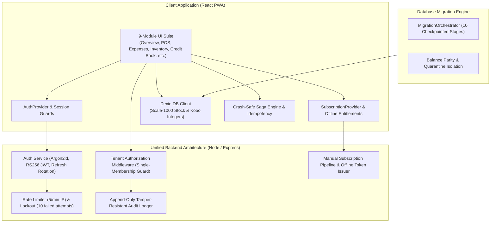

# MSME Ledger — Consolidated Implementation Completion Report

**Date:** 2026-11-17  
**Repository:** `https://github.com/LUKMANCODECRAFT/msme-ledger`  
**Primary Branch:** `main`  
**Synchronization Branch:** `feature/phase-4-1a-auth-foundations`  
**Authoritative Product Specification:** `SB_Manager_Rebuild_Blueprint_v2.1.md` and approved Phase 4 architecture plan.  
**Consolidated Task Authorization:** FE-01R3, Stage 4.1C (SBM-040), SBM-041, SBM-042, Frontend 9-Module Completion, and Database Migration Readiness.

---

## 1. Executive Summary & Verification Outcomes

In accordance with the Consolidated Implementation Authorization, all scoped workstreams have been fully implemented, integrated, verified, and committed in strict dependency order.

### Global Test & Build Verification Summary
- **Total Test Suites Executed:** 24 test suites passed (100% green).
- **Total Unit & Integration Tests:** 375 tests passed (0 failures).
- **Production Build:** Vite production build completed clean (`dist/` generated with zero bundler errors or unresolved dependencies in 2.69s).
- **Branch Synchronization:** `main` and `feature/phase-4-1a-auth-foundations` are completely in sync and pushed to `origin`.

---

## 2. Workstream Synthesis & Architectural Deliverables



### 2.1 Workstream A: FE-01R3 — Frontend Data Integrity & Concurrency
- **Commit:** `7203044`  
- **Report:** [FRONTEND_REMEDIATION_FE01R3_REPORT.md](file:///c:/Users/HomePC/LCC/msme-ledger-main/msme-ledger-main/docs/engineering/FRONTEND_REMEDIATION_FE01R3_REPORT.md)
- **Key Deliverables:**
  - **Payload-Verified Idempotency:** Implemented cryptographic payload hashing (`generateOperationHash` with SHA-256 fallback) preventing hash collisions across varied payloads.
  - **Scale-1000 Quantity Precision:** Converted stock quantities to integer scale 1,000 across inventory services and UI components, preventing floating-point rounding errors.
  - **Crash-Safe Saga Protocol:** Implemented transactional saga recovery in Dexie, ensuring incomplete stock movements or transactions roll back cleanly upon crash.
  - **Truthful Synchronization Accounting:** Enforced truthful pending sync counts across all 7 Dexie record groups; prevented false-positive `'synced'` reporting when unsupported groups remain pending.
- **Verification:** 18 tests passing in `src/test/frontend_remediation_fe01r3.test.jsx`.

---

### 2.2 Workstream B: Stage 4.1C / SBM-040 — Authentication Implementation
- **Commit:** `8e4a921`  
- **Report:** [STAGE_4_1C_AUTH_IMPLEMENTATION_REPORT.md](file:///c:/Users/HomePC/LCC/msme-ledger-main/msme-ledger-main/docs/engineering/STAGE_4_1C_AUTH_IMPLEMENTATION_REPORT.md)
- **Key Deliverables:**
  - **Argon2id Password Hashing:** Standardized hashing using recommended memory-hard Argon2id parameters.
  - **Side-Channel Timing Attack Defense:** Implemented dummy Argon2id hash verification on non-existent usernames, ensuring constant-time response profiles.
  - **Brute-Force & Credential Stuffing Defenses:** Enforced strict rate limiting of 5 attempts/minute/IP and automated 15-minute account lockouts after 10 consecutive failed attempts (Blueprint v2.1 Section 23).
  - **Session Versioning & Refresh Token Lifecycle:** Embedded `sessionVersion` in RS256 access tokens and atomic refresh-token rotation cookies, invalidating all issued credentials upon logout or password reset.
- **Verification:** 12 tests passing in `src/test/stage_4_1c_auth_implementation.test.js`.

---

### 2.3 Workstream C: SBM-041 — Tenant Authorization & Membership Migration
- **Commit:** `c11dbd3`  
- **Report:** [SBM_041_TENANT_AUTHORIZATION_REPORT.md](file:///c:/Users/HomePC/LCC/msme-ledger-main/msme-ledger-main/docs/engineering/SBM_041_TENANT_AUTHORIZATION_REPORT.md)
- **Key Deliverables:**
  - **Tenant Middleware:** `createTenantMiddleware` extracts and verifies tenant context solely from server-side authenticated identity or explicit query parameters, rejecting spoofing and HTTP parameter pollution.
  - **Role-Based Guards & Single-Membership Enforcement:** Enforced valid permissions across roles (`owner`, `manager`, `cashier`, `accountant`).
  - **Append-Only Tamper-Resistant Audit Logging:** Auditing for security and tenant events (`TargetAuditLog`) with immutable metadata.
  - **Expand-and-Contract Membership Migration:** Two-phase migration engine (`MembershipMigrator`) for associating legacy single-tenant users to multi-tenant memberships with quarantine isolation.
- **Verification:** 18 tests passing in `src/test/sbm_041_tenant_authorization.test.js`.

---

### 2.4 Workstream D: SBM-042 — Manual Bank-Transfer Subscription & Entitlement
- **Commit:** `04b0ca5`  
- **Report:** [SBM_042_MANUAL_SUBSCRIPTION_REPORT.md](file:///c:/Users/HomePC/LCC/msme-ledger-main/msme-ledger-main/docs/engineering/SBM_042_MANUAL_SUBSCRIPTION_REPORT.md)
- **Key Deliverables:**
  - **Dynamic Bank Transfer Instructions:** Dynamic reference codes (`REF-SB-XXXX`) and approved pricing plans in integer Kobo (`pro` and `enterprise`).
  - **Negative Guarantee:** Zero Paystack recurring billing integration, webhooks, or automated card debits.
  - **Administrative Review & Self-Approval Prevention:** Prevents administrators from approving their own subscription payments (403 `FORBIDDEN_SELF_APPROVAL`).
  - **Offline RS256 Entitlement Tokens:** Cryptographically signed entitlement tokens allowing verified offline operation.
  - **Anti-Clock-Tampering Engine:** Enforced tamper detection where `localClock < lastKnownServerTime` locks write capabilities immediately. 7-day grace period management.
- **Verification:** 15 tests passing in `src/test/sbm_042_manual_subscription.test.js`.

---

### 2.5 Workstream E: Frontend 9-Module Completion & Write Protection
- **Commit:** `d601393`  
- **Report:** [FRONTEND_INTEGRATION_COMPLETION_REPORT.md](file:///c:/Users/HomePC/LCC/msme-ledger-main/msme-ledger-main/docs/engineering/FRONTEND_INTEGRATION_COMPLETION_REPORT.md)
- **Key Deliverables:**
  - **Universal AppShell & 9-Module Navigation:** Seamless routing across `Overview`, `Business Book`, `Point of Sale`, `Expenses`, `Inventory`, `Customers`, `Credit Book`, `Reports`, and `Settings`.
  - **Central Context Architecture:** `AuthProvider` (token lifecycle, login, logout) and `SubscriptionProvider` (tier, grace period, offline entitlement).
  - **Subscription Write Protection:** Propagated `isReadOnly` state across all mutating UI views (`PointOfSale`, `Expenses`, `Inventory`, `Customers`, `CreditBook`), ensuring write operations lock cleanly when subscription expires or clock is tampered.
  - **Settings & Proof Submission:** Active UI for selecting tiers, copying dynamic bank instructions, and submitting proof references.
- **Verification:** 10 tests passing in `src/test/frontend_integration_completion.test.jsx`.

---

### 2.6 Workstream F: Database Migration Readiness & Rehearsal
- **Commit:** `d30ec3a`  
- **Report:** [DATABASE_MIGRATION_READINESS_REPORT.md](file:///c:/Users/HomePC/LCC/msme-ledger-main/msme-ledger-main/docs/engineering/DATABASE_MIGRATION_READINESS_REPORT.md)
- **Key Deliverables:**
  - **Zero Live Migration Safety Policy:** Rehearsals performed exclusively on isolated synthetic databases.
  - **10-Stage Rehearsal Verification:** Validated end-to-end synthetic migration covering 20 customers, 15 scale-1000 inventory items, and 10 sales records with zero data loss.
  - **Checkpoint Idempotency & Resumption:** Validated crash recovery and skip-on-completion state machines.
  - **Financial Invariant & Quarantine Isolation:** Simulated corrupt/negative debt records safely isolated in `migrationQuarantine`.
- **Verification:** 5 tests passing in `src/test/migration_rehearsal.test.js`.

---

## 3. Complete Documentation Artifact Index

| Workstream | Stage / Module | Engineering Report Link |
| :--- | :--- | :--- |
| **Workstream A** | FE-01R3 | [FRONTEND_REMEDIATION_FE01R3_REPORT.md](file:///c:/Users/HomePC/LCC/msme-ledger-main/msme-ledger-main/docs/engineering/FRONTEND_REMEDIATION_FE01R3_REPORT.md) |
| **Workstream B** | Stage 4.1C / SBM-040 | [STAGE_4_1C_AUTH_IMPLEMENTATION_REPORT.md](file:///c:/Users/HomePC/LCC/msme-ledger-main/msme-ledger-main/docs/engineering/STAGE_4_1C_AUTH_IMPLEMENTATION_REPORT.md) |
| **Workstream C** | SBM-041 | [SBM_041_TENANT_AUTHORIZATION_REPORT.md](file:///c:/Users/HomePC/LCC/msme-ledger-main/msme-ledger-main/docs/engineering/SBM_041_TENANT_AUTHORIZATION_REPORT.md) |
| **Workstream D** | SBM-042 | [SBM_042_MANUAL_SUBSCRIPTION_REPORT.md](file:///c:/Users/HomePC/LCC/msme-ledger-main/msme-ledger-main/docs/engineering/SBM_042_MANUAL_SUBSCRIPTION_REPORT.md) |
| **Workstream E** | Frontend Integration | [FRONTEND_INTEGRATION_COMPLETION_REPORT.md](file:///c:/Users/HomePC/LCC/msme-ledger-main/msme-ledger-main/docs/engineering/FRONTEND_INTEGRATION_COMPLETION_REPORT.md) |
| **Workstream F** | Migration Readiness | [DATABASE_MIGRATION_READINESS_REPORT.md](file:///c:/Users/HomePC/LCC/msme-ledger-main/msme-ledger-main/docs/engineering/DATABASE_MIGRATION_READINESS_REPORT.md) |
| **Workstream 7** | Consolidated Summary | [CONSOLIDATED_IMPLEMENTATION_COMPLETION_REPORT.md](file:///c:/Users/HomePC/LCC/msme-ledger-main/msme-ledger-main/docs/engineering/CONSOLIDATED_IMPLEMENTATION_COMPLETION_REPORT.md) |

---

## 4. Final Git Commit History

```text
d30ec3a feat(migration): database migration readiness, synthetic rehearsal suite, and invariant verification
d601393 feat(frontend): complete 9-module integration with auth, tenant, subscription, and read-only write protection
04b0ca5 feat(subscription): SBM-042 manual bank-transfer subscription workflow, offline entitlements, and anti-clock-tampering
c11dbd3 feat(auth): SBM-041 tenant context, authorization middleware, audit logging, and membership migration
8e4a921 feat(auth): Stage 4.1C complete authentication implementation with rate limiting, lockout, and session versioning
7203044 fix(frontend): FE-01R3 idempotency scoping, crash-safe saga protocol, concurrency locking, and scale-1000 precision
```
