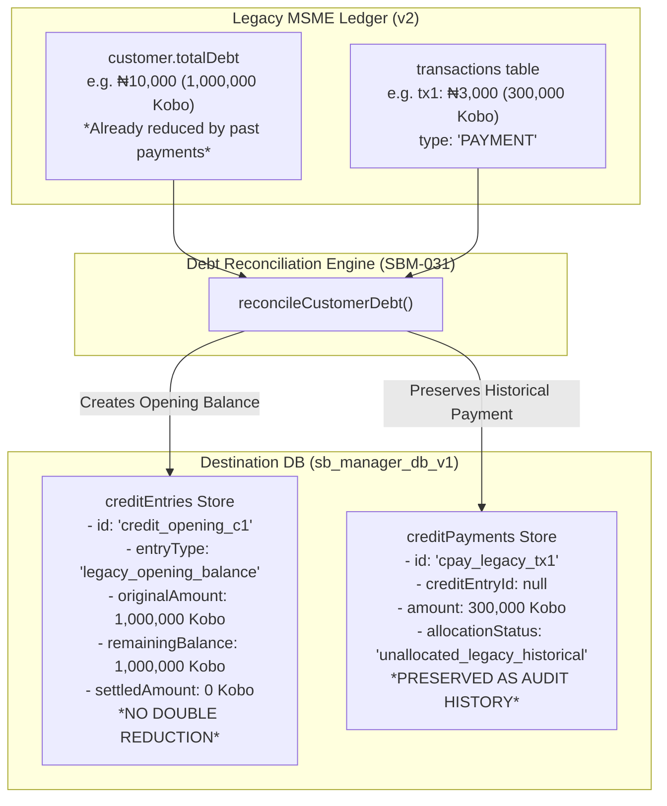

# Phase 3 Legacy Debt Reconciliation Specification (SBM-031)
## Authoritative Opening Balances & Historical Repayment Preservation

> **Document Status:** Authoritative Engineering Design Deliverable  
> **Phase:** Phase 3 (Migration Architecture & Legacy Debt Reconciliation)  
> **Ticket:** SBM-031 (Legacy Debt Reconciliation Engine)  
> **Approved Reference Specification:** SB Manager Rebuild Blueprint V2.1  
> **Delivery Date:** 2026-11-13

---

## 1. Problem Statement: Elimination of Debt Double-Counting

In early architecture versions, an opening debt entry was created from `customer.totalDebt`, and historical repayment transactions were then allocated against that opening entry.

### The Double-Counting Defect:
In the legacy MSME Ledger application, whenever a merchant logged a payment on the Debtors page ([src/pages/Debtors.jsx#L44-L77](file:///C:/Users/HomePC/LCC/msme-ledger-main/msme-ledger-main/src/pages/Debtors.jsx#L44-L77)), two operations occurred:
1. `customer.totalDebt` was reduced by the repayment amount.
2. A transaction record with `type: 'PAYMENT'` was appended to the `transactions` table.

Therefore, the current legacy `customer.totalDebt` **already reflects and has already been reduced by all historical repayments**. 

If the migration algorithm allocates those historical repayments against the opening balance again:
$$\text{Migrated Debt} = (\text{customer.totalDebt} - \text{Historical Repayments}) = \text{DOUBLE DEDUCTION!}$$
This would result in catastrophic under-reporting of receivables and merchants losing money they are legitimately owed.

---

## 2. The Approved V2.1 Debt Reconciliation Rules

In accordance with Blueprint V2.1 Section 1.1, 12, and 16:

1. **Authoritative Opening Balance:** The current legacy `customer.totalDebt` value is the authoritative opening receivable balance at migration time.
   - It is NOT reconstructed by summing historical transactions.
   - The opening `creditEntries` record is initialized with:
     - `entryType: 'legacy_opening_balance'`
     - `originalAmount: customer.totalDebt` (in integer Kobo)
     - `settledAmount: 0`
     - `remainingBalance: customer.totalDebt`
     - `status: 'open'` (or `'settled'` if totalDebt === 0)
2. **Historical Repayments As Unallocated Legacy History:**
   - Historical repayment transactions (`type === 'PAYMENT'`) from the legacy `transactions` table are transformed into `creditPayments` records.
   - They are marked with:
     - `allocationStatus: 'unallocated_legacy_historical'`
     - `creditEntryId: null`
   - They are **NEVER deducted from the opening credit entry**.
3. **No Revenue Double-Counting:** Historical repayments are recorded strictly as unallocated debt repayments; they are never counted as new sales or revenue.

---

## 3. Mathematical Proof & Numerical Verification

### Worked Example:
- **Legacy State at Migration:**
  - Customer: Alhaji Gambo (`c1`)
  - Legacy `customer.totalDebt`: `1,000,000` Kobo (₦10,000.00).
  - Historical Repayment in `transactions`: `300,000` Kobo (₦3,000.00).
- **Correct Reconciliation Result:**
  - Destination Opening Credit Entry:
    - $\text{originalAmount} = 1,000,000 \text{ Kobo}$
    - $\text{remainingBalance} = 1,000,000 \text{ Kobo}$
    - $\text{settledAmount} = 0 \text{ Kobo}$
  - Destination Credit Payment Record:
    - $\text{amount} = 300,000 \text{ Kobo}$
    - $\text{allocationStatus} = \text{'unallocated\_legacy\_historical'}$
  - **Financial Reconciled Balance:** $1,000,000 \text{ Kobo}$ (₦10,000.00).
  - **Financial Variance:** $\text{sourceDebt} (1,000,000) - \text{destCredit} (1,000,000) = \mathbf{0 \text{ Kobo}}$.

### Defective Migration Result (Prevented by SBM-031):
If repayments had been allocated:
- Destination Opening Balance: $1,000,000 - 300,000 = 700,000 \text{ Kobo}$.
- But Alhaji Gambo originally owed ₦13,000, paid ₦3,000, and still owes ₦10,000! Deducting ₦3,000 again would reduce his debt to ₦7,000, defrauding the merchant of ₦3,000. SBM-031 prevents this defect completely.

---

## 4. Edge Cases Handled

| Edge Case Scenario | Engine Behavior | Destination Result |
|---|---|---|
| **Zero Debt (`totalDebt: 0`)** | Detects zero debt without error. | `reconciliationStatus: 'zero_debt'`. No open credit entry created. |
| **Positive Debt, No Transactions** | Authoritative balance preserved. | Opening credit entry created for full `totalDebt`. Zero payments. |
| **Repayment Sum > Opening Balance** | Authoritative balance preserved. Flagged in notes. | Opening credit entry has `originalAmount: totalDebt`. Repayments recorded as unallocated history. |
| **Duplicate Transaction IDs** | Deduplicates by `tx.id` using in-memory Set. | Exactly one `creditPayment` created per transaction ID. |
| **Malformed / Negative Debt (`< 0`)** | Quarantined via `MigrationQuarantineManager`. | Zero credit entries created. Quarantined for merchant audit. |
| **Ambiguous Currency Magnitude** | Quarantined via `MigrationQuarantineManager`. | Excluded from verified financial totals. Awaits operator clarification. |
| **Orphaned Transactions** | Transaction references customerId not in customers table. | Quarantined with reason `ORPHAN_TRANSACTION_CUSTOMER_NOT_FOUND`. |

