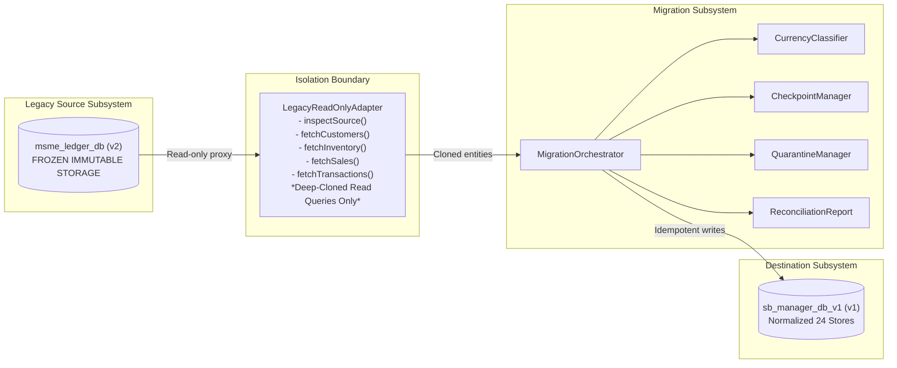

# Phase 3 Migration Architecture Specification (SBM-030)
## Safe, Resumable, Auditable Dual-Database Migration Pipeline

> **Document Status:** Authoritative Engineering Design Deliverable  
> **Phase:** Phase 3 (Migration Architecture & Legacy Debt Reconciliation)  
> **Ticket:** SBM-030 (Controlled Migration Architecture)  
> **Approved Reference Specification:** SB Manager Rebuild Blueprint V2.1  
> **Execution Mode:** Controlled Architecture & Synthetic Testing Only (Zero live migration)  
> **Delivery Date:** 2026-11-13

---

## 1. Architectural Principles & Isolation Boundaries

### 1.1 Strictly Narrowed Read-Only Adapter (`LegacyReadOnlyAdapter`)
To guarantee that the legacy database (`msme_ledger_db`) can never be modified, corrupted, or deleted by migration code, all legacy data access is strictly encapsulated within [LegacyReadOnlyAdapter](file:///C:/Users/HomePC/LCC/msme-ledger-main/msme-ledger-main/src/domain/migration/legacyAdapter.js):

- **No Exposed Database Instance:** The underlying `Dexie` instance is kept as an unexposed internal reference. The adapter does not return or expose `this._db`.
- **No Database Lifecycle Access:** Dangerous methods—such as `delete()`, `version()`, `open()`, `close()`, `upgrade()`, `table()`, and `transaction()`—are completely omitted from the adapter's public API.
- **Deep-Cloned Extractions:** All extraction queries (`fetchCustomers()`, `fetchInventory()`, `fetchSales()`, `fetchTransactions()`) return deep-cloned records via `structuredClone()`, guaranteeing that in-memory mutations by migration code cannot alter cached IndexedDB records.
- **Dependency Injection:** The migration orchestrator accepts `legacyAdapter` as an injected dependency, decoupling the migration engine from any global database singleton.



---

## 2. The 10-Stage Controlled Migration Pipeline

The migration pipeline is decomposed into 10 decoupled, independently testable stages:

1. **Source Inspection:** Reads source database metadata, table declarations, and record counts via `legacyAdapter.inspectSource()`.
2. **Business Identity Verification:** Validates that the target business record exists in `targetDb.businesses` with `identityStatus: 'unresolved_unclaimed'`, preventing premature tenant claiming.
3. **Record Extraction:** Fetches cloned legacy records by entity batch.
4. **Validation:** Checks required fields (e.g. non-empty customer name, non-empty product name). Records with validation failures are quarantined.
5. **Currency & Unit Classification:** Applies `classifyCurrency()` to each monetary field. Unverified or ambiguous amounts are quarantined.
6. **Quarantine Isolation:** Isolates unresolvable records into `MigrationQuarantineManager` without data loss or silent zeroing.
7. **Destination Transformation:** Maps legacy entities into normalized SB Manager schema contracts (Scale 1,000 quantities, integer Kobo, unvalued legacy cost tracking).
8. **Idempotent Destination Writes:** Executes atomic writes to destination stores (`customers`, `products`, `stockMovements`, `sales`, `creditEntries`, `creditPayments`).
9. **Reconciliation:** Computes financial balances, inventory counts, and entity tallies, asserting zero debt variance.
10. **Completion Verification:** Persists final checkpoint and quarantine registry to `targetDb.migrationCheckpoints`.

---

## 3. Durable Checkpoint State Machine (`MigrationCheckpointManager`)

Migration progress is persisted to the destination `migrationCheckpoints` store using [MigrationCheckpointManager](file:///C:/Users/HomePC/LCC/msme-ledger-main/msme-ledger-main/src/domain/migration/checkpoints.js).

### 3.1 Checkpoint Schema
```javascript
{
  stage: 'customers_and_debt',      // Primary Key
  migrationRunId: 'run_1763051200', // Unique execution run
  sourceVersion: 2,                 // Legacy schema version
  migrationVersion: 1,              // Migration engine version
  status: 'completed',              // 'pending' | 'in_progress' | 'completed' | 'failed'
  totalRecords: 150,
  processedRecords: 150,
  successfulRecords: 148,
  skippedRecords: 0,
  quarantinedRecords: 2,
  failedRecords: 0,
  lastProcessedId: 'cust-uuid-150',
  startedAt: '2026-11-13T17:00:00.000Z',
  completedAt: '2026-11-13T17:00:02.150Z',
  errorDetails: null
}
```

### 3.2 Resumption & Idempotency Rules
- If a stage checkpoint status is `'completed'`, the orchestrator skips the stage entirely upon restart.
- If a stage is `'failed'` or `'in_progress'`, the orchestrator resumes processing using `lastProcessedId`.
- Destination writes use deterministic primary keys (e.g. preserving legacy UUIDs or deterministic prefixes `credit_opening_${customerId}`), guaranteeing that retries cannot duplicate records.

---

## 4. Evidence-Based Currency Classification (`CurrencyClassifier`)

In accordance with owner decisions, the classifier strictly enforces:  
**"NEVER assume every integer greater than or equal to 50 represents Kobo."**

| Condition | Classification Result | Destination Handling |
|---|---|---|
| Null, undefined, empty string | `AMBIGUOUS_QUARANTINE` | Quarantined (`MISSING_AMOUNT`). Excluded from financial totals. |
| Non-numeric string, boolean, NaN | `AMBIGUOUS_QUARANTINE` | Quarantined (`MALFORMED_NON_NUMERIC`). |
| Fractional decimal (e.g. `500.5`) | `AMBIGUOUS_QUARANTINE` | Quarantined (`FRACTIONAL_DECIMAL_NOT_PERMITTED`). |
| Unsafe integer (`> Number.MAX_SAFE_INTEGER`) | `AMBIGUOUS_QUARANTINE` | Quarantined (`UNSAFE_INTEGER_MAGNITUDE`). |
| Value is exactly `0` | `ZERO_BALANCE` | Verified as 0 Kobo without ambiguity. |
| Negative value (`< 0`) | `AMBIGUOUS_QUARANTINE` | Quarantined (`NEGATIVE_AMOUNT_PROHIBITED`). |
| Explicit `KOBO` contract verified | `VERIFIED_KOBO` | Preserved as integer Kobo ($n$). |
| Explicit `NAIRA` contract verified | `VERIFIED_NAIRA` | Normalized to Kobo ($n \times 100$). |
| Auto without corroborating evidence | `AMBIGUOUS_QUARANTINE` | Quarantined (`AMBIGUOUS_CURRENCY_MAGNITUDE_NO_EVIDENCE`). |

---

## 5. Lossless Migration Quarantine Subsystem (`MigrationQuarantineManager`)

When a legacy record fails structural validation or monetary classification, it is quarantined via [MigrationQuarantineManager](file:///C:/Users/HomePC/LCC/msme-ledger-main/msme-ledger-main/src/domain/migration/quarantine.js).

### Quarantine Record Contract:
```javascript
{
  quarantineId: 'quar_customers_cust-099_1763051200',
  migrationRunId: 'run_1763051200',
  sourceEntity: 'customers',
  sourceId: 'cust-099',
  rawRecord: { id: 'cust-099', name: '', totalDebt: 250 },
  reason: 'MISSING_CUSTOMER_NAME',
  validationErrors: ['Customer record lacks a valid name string.'],
  detectedAt: '2026-11-13T17:00:01.000Z',
  resolutionStatus: 'unresolved',
  resolutionHistory: []
}
```
All quarantined records are persisted durably into `targetDb.migrationCheckpoints` under the stage `'quarantine_registry'`. They are never silently discarded and never defaulted to zero.

