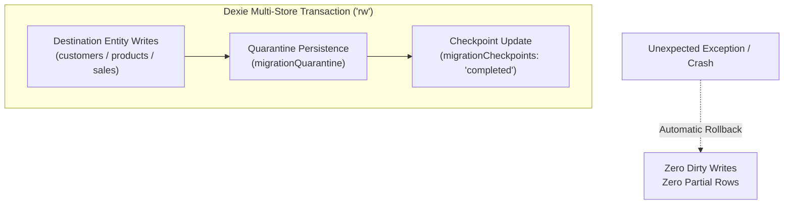

# Phase 3 Schema Consistency, Explicit Versioning & Decoupling
## Dexie `sb_manager_db_v1`, Legacy `msme_ledger_db`, and Mongoose Schemas

> **Document Status:** Authoritative Architecture Reference  
> **Phase:** Phase 3 Remediation & Schema Version Finalization  
> **Specification:** SB Manager Rebuild Blueprint V2.1  
> **Delivery Date:** 2026-11-13  
> **Active Dexie Database Version:** Version 2 (`sb_manager_db_v1`)

---

## 1. Schema Decoupling: Checkpoints vs. Quarantine

In the initial Phase 3 implementation, quarantined records were stored as an embedded array inside a synthetic record in `migrationCheckpoints` (`stage: 'quarantine_registry'`).

Under **SBM-030-A**, this conflation was eliminated by creating a dedicated, normalized Dexie store: `migrationQuarantine`.

### Architectural Comparison

| Dimension | `migrationCheckpoints` | `migrationQuarantine` |
|---|---|---|
| **Purpose** | Pipeline progress, stage resumption, and idempotency states | Storage of unverified, malformed, or ambiguous legacy records |
| **Primary Key** | `stage` (e.g. `'customers_and_debt'`) | `quarantineId` (e.g. `'quar_customers_c3'`) |
| **Indexed Fields** | None (keyed by stage) | `migrationRunId`, `sourceEntity`, `sourceId`, `resolutionStatus`, `detectedAt` |
| **Granularity** | Stage-level | Record-level (independently addressable) |
| **Queryability** | Key lookup by stage | Indexed queries by entity type, resolution status, or run ID |
| **Mutability** | Updated as pipeline stages progress | Updated only upon explicit manual resolution event |
| **History Trail** | `startedAt`, `completedAt`, `errorDetails` | `resolutionHistory` array capturing full operator audit trail |

---

## 2. Explicit Dexie Schema Versioning & Evolution

To guarantee seamless upgrades from prior Phase 2 databases without relying on dynamic `SchemaDiff` workarounds, `sb_manager_db_v1` declares explicit versions:

### 2.1 Version 1: Phase 2 Baseline Schema (24 Stores)
Declared as `SB_DB_STORES_V1`:
```javascript
export const SB_DB_STORES_V1 = {
  businesses: 'id, type, identityStatus, updatedAt',
  users: 'id, email',
  memberships: 'id, businessId, userId',
  customers: 'id, businessId, phone, name, isArchived, sync_status, updatedAt',
  products: 'id, businessId, name, sku, hasVerifiedCost, isArchived, sync_status, updatedAt',
  services: 'id, businessId, name, isArchived, sync_status, updatedAt',
  inventoryPurchases: 'id, businessId, purchaseNumber, paymentStatus, purchaseDate, sync_status',
  purchasePayments: 'id, purchaseId, businessId, paymentDate, sync_status',
  stockMovements: 'id, businessId, productId, movementType, referenceId, movementDate, sync_status',
  sales: 'id, businessId, customerId, saleDate, paymentStatus, sync_status, clientRevision, updatedAt',
  salePayments: 'id, saleId, businessId, paymentMethod, paymentDate, sync_status',
  creditEntries: 'id, businessId, customerId, saleId, status, dueDate, sync_status, updatedAt',
  creditPayments: 'id, creditEntryId, customerId, businessId, allocationStatus, paymentDate, sync_status',
  creditAdjustments: 'id, creditEntryId, businessId, adjustmentType, adjustedAt, sync_status',
  expenses: 'id, businessId, categoryId, paymentStatus, expenseDate, sync_status, updatedAt',
  expensePayments: 'id, expenseId, businessId, paymentDate, sync_status',
  expenseCategories: 'id, businessId, name',
  incomeEntries: 'id, businessId, source, receivedDate, sync_status',
  ownerEquityTransactions: 'id, businessId, transactionType, transactionDate, sync_status',
  financialReversals: 'id, businessId, targetEntityType, targetEntityId, reversedAt, sync_status',
  auditLogs: 'id, businessId, entityType, entityId, timestamp',
  settings: 'id, businessId, updatedAt',
  syncQueue: 'operationId, entityType, entityId, clientRevision, status, queuedAt',
  migrationCheckpoints: 'stage'
};
```

### 2.2 Version 2: Phase 3 Schema Evolution (25 Stores)
Declared as `SB_DB_STORES_V2`:
```javascript
export const SB_DB_STORES_V2 = {
  ...SB_DB_STORES_V1,
  migrationQuarantine: 'quarantineId, migrationRunId, sourceEntity, sourceId, resolutionStatus, detectedAt'
};
```

### 2.3 Explicit Upgrade Path
In `src/config/db.js`:
```javascript
// Version 1: Phase 2 baseline 24 stores
sb_db.version(1).stores(SB_DB_STORES_V1);

// Version 2: Additive upgrade declaring dedicated migrationQuarantine store
sb_db.version(2).stores({
  migrationQuarantine: 'quarantineId, migrationRunId, sourceEntity, sourceId, resolutionStatus, detectedAt'
});
```

### 2.4 Additive Upgrade & Data Preservation Verification
This explicit upgrade declaration guarantees:
1. **Fresh Installation:** Initializes directly at `verno: 2` with all 25 tables.
2. **Existing Database Upgrade:** Upgrades an existing `version(1)` database to `version(2)` natively without emitting any `Dexie SchemaDiff` warnings.
3. **Data Preservation:** Zero data loss. Existing records in `businesses`, `customers`, `products`, `sales`, and `migrationCheckpoints` remain completely intact.
4. **Automated Test Coverage:** Verified in `src/test/dexie_databases.test.js` (Test 7).

---

## 3. Dedicated `migrationQuarantine` Schema Specification

Each record in `migrationQuarantine` conforms to the following contract:

```typescript
interface MigrationQuarantineRecord {
  quarantineId: string;             // PK: `quar_${sourceEntity}_${sourceId}`
  migrationRunId: string;           // Run identifier (e.g. `run_1731512345678`)
  sourceEntity: 'customers' | 'inventory' | 'sales' | 'transactions';
  sourceId: string;                 // Original legacy record identifier
  rawRecord: Record<string, any>;   // Deep-cloned lossless snapshot of legacy record
  reason: string;                   // Explicit machine-readable reason code
  validationErrors: string[];       // Human-readable diagnostic reasons
  detectedAt: string;               // ISO 8601 timestamp
  resolutionStatus: 'unresolved' | 'resolved' | 'ignored' | 'manually_adjusted';
  resolutionHistory: Array<{        // Immutable audit log of resolution events
    timestamp: string;
    previousStatus: string;
    newStatus: string;
    resolvedBy: string;
    notes: string;
    resolvedPayload?: any;
  }>;
  resolvedAt?: string;
  updatedAt: string;
}
```

---

## 4. Multi-Store Transaction Boundaries

To prevent partial writes on process interruption or crash, all stage destination writes, quarantine writes, and checkpoint updates are bound within native Dexie read-write transactions:



### Registered Stores per Stage Transaction:
- **`business_identity`**: `[businesses, migrationCheckpoints]`
- **`customers_and_debt`**: `[customers, creditEntries, creditPayments, migrationQuarantine, migrationCheckpoints]`
- **`inventory_and_stock`**: `[products, stockMovements, migrationQuarantine, migrationCheckpoints]`
- **`sales_and_history`**: `[sales, salePayments, migrationQuarantine, migrationCheckpoints]`
- **`reconciliation`**: `[migrationQuarantine, migrationCheckpoints]`

---

## 5. Mongoose Server Schema Alignment

The Mongoose models in `server/src/models/target/` enforce compound uniqueness on `[businessId, id]` across all domain entities, matching Dexie multi-tenant semantics:
- `Customer`: Compound unique index `{ businessId: 1, id: 1 }`
- `Product`: Compound unique index `{ businessId: 1, id: 1 }`
- `StockMovement`: Compound unique index `{ businessId: 1, id: 1 }`
- `Sale`: Compound unique index `{ businessId: 1, id: 1 }`
- `CreditEntry`: Compound unique index `{ businessId: 1, id: 1 }`
- `CreditPayment`: Compound unique index `{ businessId: 1, id: 1 }`

This guarantees end-to-end multi-tenant isolation and parity between client-side Dexie and cloud MongoDB sync endpoints.
