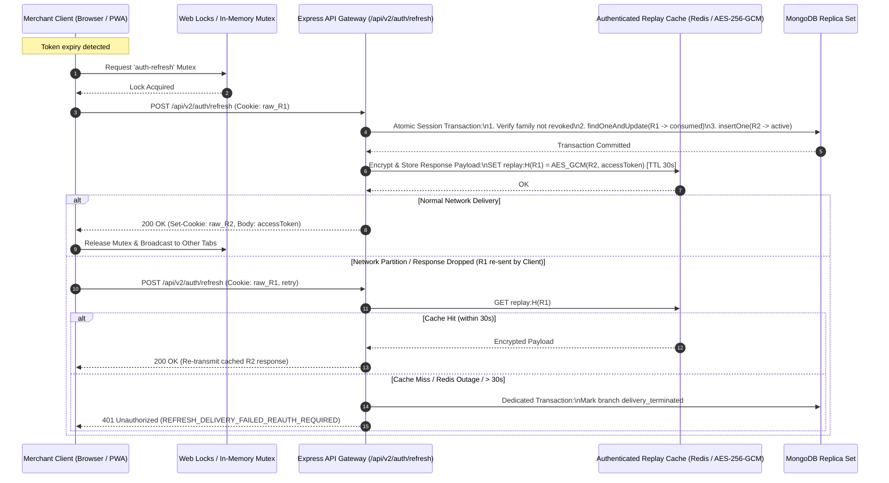
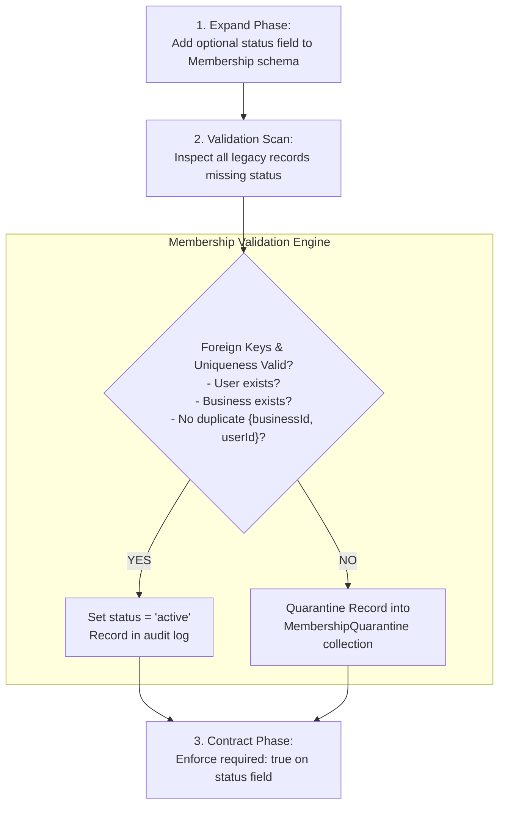

# SB Manager Rebuild: Phase 4 Architecture & Implementation Plan (Fourth Revision)
## Authentication, Multi-Tenant Authorization, and Manual Subscription Services
### Authorized Planning Tickets: SBM-040, SBM-041, and SBM-042

> **Document Status:** Authoritative Architectural Specification & Implementation Plan (Post-Fourth Review Revision)  
> **Phase:** Phase 4 (Authentication, Authorization & Subscription Services)  
> **Approved Specification Reference:** `SB_Manager_Rebuild_Blueprint_v2.1.md` (Sections 14, 15, 20, 23, 24)  
> **Target Subsystems:**
> - Backend API Gateway & Express Server (`server/`)
> - Client Offline Security & Entitlement Engine (`src/domain/auth/`)
> **Execution Mode:** **STRICT PLANNING ONLY — STRICT READ-ONLY REVIEW — PENDING OWNER APPROVAL**

---

## 1. Executive Summary & Implementation Readiness Verdict

### Overall Readiness Verdict: **CONDITIONALLY READY — OWNER DECISIONS REQUIRED**

Phase 4 establishes the identity perimeter, multi-tenant boundaries, role-based access controls (RBAC), platform administration segregation, and manual subscription lifecycle for **SB Manager**. This fourth revision comprehensively resolves all outstanding defects identified during previous architecture reviews:
1. Replaced ambiguous refresh-token recovery with a mathematically coherent, two-tier concurrency and delivery-retry contract with explicit bearer-token security trade-offs.
2. Corrected platform administrator self-approval checks across multi-identity relationships, preventing administrator self-approvals under any alias or owned merchant profile.
3. Established atomic conditional state transitions for both payment intents and submissions within a single session transaction, guaranteeing idempotency.
4. Replaced undefined runtime subscription string states with request-time derived effective states based on explicit integer Unix timestamps.
5. Standardized RS256 token verification equality boundaries across server and client, guaranteeing that offline clients with unknown keys strictly fail-closed.
6. Replaced raw membership updates with a validated, expand-and-contract migration specification with quarantine tables.
7. Conducted a complete inventory of all legacy routes, formally neutralizing unauthenticated legacy endpoints.
8. Retained automated legacy business claim challenges as **BLOCKED**, establishing an asymmetric, single-use manual claim token protocol.
9. Reconciled the Blueprint v2.1 Section 23 login rate-limiting policy and documented the trade-offs of account lockout.

### Subsystem Assessment:
- **SBM-040 (Authentication & Token Lifecycle):** **CONDITIONALLY RESOLVED** (Token state transitions, delivery recovery, and admin RBAC specified; email verification, password reset, and rate-limit thresholds remain unapproved owner decisions).
- **SBM-041 (Tenant Authorization & Legacy Route Isolation):** **CONDITIONALLY RESOLVED** (Tenant context fallback, database-level scoping, and complete legacy route neutralization defined; automated legacy claim is explicitly **BLOCKED**).
- **SBM-042 (Manual Subscription & Entitlement Architecture):** **CONDITIONALLY RESOLVED** (Persistent payment intents, derived duration rules, magic-byte checks, and offline verification engine specified; billing durations, pricing tiers, and grace duration remain unapproved owner decisions).

---

## 2. Mandatory Project Context & Baseline Invariants

### Repository & Workspace Context:
- **Repository URL:** `https://github.com/LUKMANCODECRAFT/msme-ledger`
- **Application Source Root:** `C:\Users\HomePC\LCC\msme-ledger-main\msme-ledger-main`
- **Current Regression Baseline:** Exactly **62 passing tests across 8 suites** running under Vitest 2.1.8 with clean Vite production builds.
- **Execution Boundary:** Zero modifications to application source files, test suites, database schemas, migrations, or package dependencies are authorized.

### Confirmed Owner Decisions (INVIOLABLE — PRESERVED):
1. **Authentication Mode:** Email and password mandatory.
2. **Subscription Payment Mode:** Manual bank-transfer confirmation mandatory.
3. **PWA Updates:** Prompt the user before reloading mandatory.
4. **Historical Inventory Costs:** Unknown legacy costs remain strictly separate from verified purchase costs and verified gross profit calculations.
5. **Quantity Precision:** Integer scale factor of 1,000 mandatory across inventory and sales models.

### Unapproved Owner Decisions (MARKED EXPLICITLY AS UNAPPROVED):
The following decisions remain strictly unapproved proposals. None are treated as final:
- Offline grace-period duration (e.g. 7 days vs 14 days).
- Billing cycle durations (e.g. 30 days vs calendar month vs 90 days vs 365 days).
- Subscription prices (including the previously proposed ₦5,000 monthly tier).
- Subscription plan tiers and feature entitlements.
- Email verification policy (strict blocking vs permissive with banner).
- Password recovery policy (self-service email vs admin-assisted).
- Transactional email provider selection.
- Frontend/API deployment topology (Same-domain reverse proxy vs Subdomain vs Multi-cloud).
- Platform administrator provisioning procedure.
- Payment-proof storage infrastructure and document retention policies.
- Platform administrator Multi-Factor Authentication (MFA) enforcement.
- Any numeric rate-limit or account-lockout thresholds amending Blueprint v2.1 Section 23.

---

## 3. Repository Architecture Findings & Route Inventory

### 3.1 Existing Repository State:
1. **Target Mongoose Schemas (`server/src/models/target/coreModels.js`):**
   - `User`: Declares `id`, `email`, `passwordHash`, `fullName`, `isEmailVerified`. **Lacks:** `defaultBusinessId`, `failedLoginAttempts`, `lockoutUntil`.
   - `Business`: Declares `id`, `name`, `type`, `currency`, `identityStatus` (`verified_claimed` vs `unresolved_unclaimed`).
   - `Membership`: Declares `id`, `userId`, `businessId`, `role` (`owner`, `manager`, `cashier`). Compound index `{ businessId: 1, userId: 1 }`. **Lacks:** `status` (`active`, `revoked`).
   - **Missing Models:** `RefreshToken`, `SubscriptionPaymentIntent`, `SubscriptionSubmission`, `Subscription`, `PlatformAdmin`, `AdminAuditLog`, `LegacyBusinessClaimToken`, and `MembershipQuarantine` do not exist yet.
2. **Client Dexie Architecture (`src/config/db.js`):**
   - Declares `sb_manager_db_v1` with Version 1 (24 stores) and Version 2 (25 stores, adding `migrationQuarantine`).

### 3.2 Complete Express Server Route Inventory & Security Transition:
Every route mounted in `server/src/server.js` and its controllers has been inventoried and classified:

| Route Path | Method | Existing Legacy Behavior | Phase 4 Security Classification | Access Control / Transition Policy |
|---|:---:|---|---|---|
| `/api/v1/sync` | `POST` | Unauthenticated; trusts client-supplied body `shopId`. | **DISABLED (410 GONE)** | Neutralized. Returns `410 Gone` with `{ error: 'LEGACY_SYNC_DEPRECATED', message: 'Use authenticated v2 sync.' }`. |
| `/api/v1/admin/stats` | `GET` | Authenticated via insecure query param `?key=`. | **DISABLED (410 GONE)** | Neutralized. Returns `410 Gone`. Migrated to `GET /api/v2/admin/stats`. |
| `/api/v2/auth/register` | `POST` | Does not exist. | **PUBLIC** | Rate-limited. Atomic User/Business/Membership creation. |
| `/api/v2/auth/login` | `POST` | Does not exist. | **PUBLIC** | Rate-limited. Constant-time dummy verification. Returns access JWT + HttpOnly refresh cookie. |
| `/api/v2/auth/refresh` | `POST` | Does not exist. | **COOKIE-AUTHENTICATED** | Single-flight client mutex + 30s ephemeral replay cache + family invalidation on replay. |
| `/api/v2/auth/logout` | `POST` | Does not exist. | **AUTHENTICATED** | Revokes presented refresh token in DB; clears cookie. |
| `/api/v2/auth/logout-all` | `POST` | Does not exist. | **AUTHENTICATED** | Revokes all active refresh tokens for user in DB. |
| `/api/v2/admin/auth/login` | `POST` | Does not exist. | **PUBLIC ADMIN** | Rate-limited. Dedicated platform admin authentication issuing `platform_admin_access` tokens. |
| `/api/v2/admin/stats` | `GET` | Does not exist. | **PLATFORM-ADMIN-ONLY** | Protected by `requirePlatformRole(['super_admin', 'support_admin'])`. Real-time active status check. |
| `/api/v2/admin/subscriptions/pending` | `GET` | Does not exist. | **PLATFORM-ADMIN-ONLY** | Protected by `requirePlatformRole(['super_admin', 'finance_admin'])`. Lists pending submissions. |
| `/api/v2/admin/subscriptions/:id/approve` | `POST` | Does not exist. | **PLATFORM-ADMIN-ONLY** | Protected by `requirePlatformRole(['super_admin', 'finance_admin'])`. Atomic conditional approval. |
| `/api/v2/admin/subscriptions/:id/reject` | `POST` | Does not exist. | **PLATFORM-ADMIN-ONLY** | Protected by `requirePlatformRole(['super_admin', 'finance_admin'])`. Atomic rejection state transition. |
| `/api/v2/admin/claims/issue-token` | `POST` | Does not exist. | **PLATFORM-ADMIN-ONLY** | Protected by `requirePlatformRole(['super_admin', 'support_admin'])`. Issues single-use Claim Token. |
| `/api/v2/subscription/plans` | `GET` | Does not exist. | **AUTHENTICATED** | Returns approved plans from canonical catalogue. Rejects unapproved plans. |
| `/api/v2/subscription/intent` | `POST` | Does not exist. | **AUTHENTICATED TENANT** | `requireRole(['owner', 'manager'])`. Pre-allocates reference bound to business, plan, amount. |
| `/api/v2/subscription/instructions` | `GET` | Does not exist. | **AUTHENTICATED TENANT** | `requireRole(['owner', 'manager'])`. Returns bank details + intent reference. |
| `/api/v2/subscription/submit` | `POST` | Does not exist. | **AUTHENTICATED TENANT** | `requireRole(['owner', 'manager'])`. Magic-byte file validation, binds submission to intent. |
| `/api/v2/subscription/entitlement` | `GET` | Does not exist. | **AUTHENTICATED TENANT** | `requireRole(['owner', 'manager', 'cashier'])`. Retrieves signed RS256 entitlement token. |
| `/api/v2/subscription/proof/:id` | `GET` | Does not exist. | **AUTHENTICATED ACCESS** | Authorized download for submitting merchant or authorized finance/super admin only. |
| `/api/v2/businesses/:id/claim` | `POST` | Does not exist. | **BLOCKED** | **BLOCKED PENDING APPROVED OWNER DESIGN.** Only single-use manual Claim Token submission permitted. |

---

## 4. SBM-040: Authentication, Session Management & Refresh-Token Lifecycle

### 4.1 Cryptographic Standards & Database-Level Email Collation
- **Password Hashing:** **Argon2id** (strictly conforming to Blueprint Section 14.1):
  - Memory cost: $m = 65,536 \text{ KiB}$ (64 MB)
  - Time cost: $t = 3$ iterations
  - Parallelism: $p = 4$ threads
  - Salt: 16 cryptographically random bytes generated via `crypto.randomBytes(16)`
  - Standard Modular Crypt Format output string (`$argon2id$v=19$m=65536,t=3,p=4$...`).
- **Application Normalization:** `normalizedEmail = email.trim().toLowerCase()`.
- **Database Index & Collation Strategy:**
  ```javascript
  userSchema.index(
    { email: 1 },
    { unique: true, collation: { locale: 'en', strength: 2 } }
  );
  ```
  Guarantees that case variants collide at the database level across all application write paths, eliminating race conditions.
- **Timing-Attack Mitigation:**
  If an email is not found during login, the server executes a dummy Argon2id hash verification against a constant pre-hashed string to equalize execution time before returning generic `401 Unauthorized` (`INVALID_CREDENTIALS`).

### 4.2 Standardized Access Token Specification (RS256 Uniformity)
- **Algorithm:** **RS256** exclusively.
- **Key Management:**
  - Private Signing Key (`JWT_PRIVATE_KEY`): Maintained strictly server-side in secure environment variables or secret vaults. Never exposed to frontend code or client storage.
  - Public Verification Key (`JWT_PUBLIC_KEY`): Distributed via `GET /.well-known/jwks.json` or bundled into client verification modules.
  - Key ID (`kid`): Mandatory header parameter (e.g. `kid: "sb-auth-2026-v1"`) supporting zero-downtime key rotation.
- **Lifetime:** Exactly 15 minutes (`900` seconds).
- **Token Claims Schema (Strict Integer Unix Seconds):**
  ```json
  {
    "iss": "sb-manager-auth",
    "aud": "sb-manager-client",
    "sub": "usr_9b1deb4d-3b7d-4bad-9bdd-2b0d7b3dcb6d",
    "iat": 1773532800,
    "exp": 1773533700,
    "jti": "8f3b2e1a-4c5d-6e7f-8a9b-0c1d2e3f4a5b",
    "token_use": "access",
    "token_type": "merchant_access",
    "email": "merchant@example.com",
    "defaultBusinessId": "biz_a1b2c3d4-e5f6-7a8b-9c0d-1e2f3a4b5c6d"
  }
  ```
- **Verification Allowlist:** Middleware enforces `algorithms: ['RS256']`, rejecting any symmetric (`HS256`) or unsigned (`none`) tokens.

### 4.3 Refresh-Token Lifecycle, Concurrency & Delivery-Loss Recovery Contract

#### The Technical Challenge:
The database stores only `tokenHash = SHA256(rawToken)`. When a token is consumed and replaced by $R_2$, the server **cannot** re-read or re-issue $R_2$ from the database because one-way hashing makes raw secret reconstruction mathematically impossible. If the client fails to receive $R_2$ due to network partition or crash:
- Retrying with $R_1$ must not immediately revoke the family as an attack.
- Concurrently refreshing tabs must not create competing branches.



#### Authoritative RefreshToken Schema (`server/src/models/target/authModels.js`):
```javascript
const refreshTokenSchema = new mongoose.Schema({
  id: { type: String, required: true, unique: true },
  userId: { type: String, required: true, index: true },
  tokenHash: { type: String, required: true, unique: true },
  familyId: { type: String, required: true, index: true },
  status: {
    type: String,
    enum: ['active', 'consumed', 'revoked', 'delivery_terminated'],
    default: 'active',
    index: true
  },
  replacedByHash: { type: String, default: null },
  consumedAt: { type: Date, default: null },
  revokedAt: { type: Date, default: null },
  reuseDetectedAt: { type: Date, default: null },
  expiresAt: { type: Date, required: true, index: { expires: 0 } },
  userAgent: { type: String, default: null },
  ipAddress: { type: String, default: null },
  createdAt: { type: Date, default: Date.now }
}, { versionKey: false, timestamps: true });

refreshTokenSchema.index({ familyId: 1, status: 1 });
export const RefreshToken = mongoose.model('TargetRefreshToken', refreshTokenSchema);
```

#### The Two-Tier Timing & Recovery Contract:
Let $t_{\text{present}}$ be the time $R_1$ is presented to `/api/v2/auth/refresh`, and $t_{\text{consumed}}$ be $R_1$'s `consumedAt` timestamp. Let $\Delta t = t_{\text{present}} - t_{\text{consumed}}$.

1. **Tier 1 ($\Delta t \le 10\text{s}$ — Concurrent Refresh Window):**
   - Multiple browser tabs wake up simultaneously. Tab A wins the atomic rotation. Tab B presents $R_1$ milliseconds later.
   - The server inspects $R_1$: `status === 'consumed'` and $\Delta t \le 10\text{s}$.
   - The server **does not revoke the token family**.
   - The server returns `409 Conflict` (`CONCURRENT_REFRESH_IN_PROGRESS`, `Retry-After: 1s`). Tab B pauses, intercepts the newly set cookie $R_2$ established by Tab A, and proceeds.
2. **Tier 2 ($10\text{s} < \Delta t \le 30\text{s}$ — Network Delivery Retry Window):**
   - The server committed $R_1 \to R_2$, but the client never received $R_2$ due to connection drop.
   - The client retries presenting $R_1$.
   - **Authenticated Ephemeral Cache:** The server queries Redis / distributed memory cache for `replay:H(R1)`.
   - If found, the server decrypts the payload (AES-256-GCM) and re-transmits the exact response package containing $R_2$ and the access token.
   - **Security Limitation Acknowledgment:** *Because $R_1$ is a bearer token, re-issuing $R_2$ to anyone presenting $R_1$ during this 30-second window means an in-flight network attacker who captured $R_1$ could obtain $R_2$. Without hardware device binding (mTLS/DPoP), distinguishing a legitimate network retry from an attacker possessing $R_1$ over the wire during this window is mathematically impossible.*
   - **Cache Outage / Eviction Fallback:** If Redis is down, cache key evicted, or server restarted, the server cannot reconstruct $R_2$. The server marks the token `status: 'delivery_terminated'`, clears the cookie, and returns `401 Unauthorized` (`REFRESH_DELIVERY_FAILED_REAUTH_REQUIRED`). The merchant re-authenticates with email and password without triggering false-positive family revocation.
3. **Tier 3 ($\Delta t > 30\text{s}$ — Suspicious Replay Attack Window):**
   - Token $R_1$ is presented long after any network retry or tab race could plausibly occur.
   - An adversary has replayed a spent token.
   - **Committed Revocation Transaction:** In an independent, committed transaction, the server marks all tokens in the `familyId` as `status: 'revoked'`, `revokedAt: new Date()`, `reuseDetectedAt: new Date()`.
   - The server clears the cookie and returns `401 Unauthorized` (`TOKEN_FAMILY_COMPROMISED`).

#### Atomic Family State Check Invariant:
To prevent a concurrent refresh from creating a replacement token after its family has been revoked, the rotation transaction strictly enforces:
```javascript
const revokedTokensInFamily = await RefreshToken.findOne({
  familyId: currentToken.familyId,
  status: 'revoked'
}).session(session);

if (revokedTokensInFamily) {
  throw new UnauthorizedError('TOKEN_FAMILY_ALREADY_REVOKED');
}
```

---

## 5. Platform Administrator Security Architecture

### 5.1 Segregated Identity Model (`PlatformAdmin`)
Platform administrators exist in a dedicated collection, entirely separate from merchant `users`:
```javascript
const platformAdminSchema = new mongoose.Schema({
  id: { type: String, required: true, unique: true },
  email: { type: String, required: true, unique: true, lowercase: true, trim: true },
  passwordHash: { type: String, required: true },
  fullName: { type: String, required: true },
  role: {
    type: String,
    enum: ['super_admin', 'finance_admin', 'support_admin'],
    required: true
  },
  linkedMerchantUserIds: [{ type: String }], // Array supporting multiple merchant identities
  isActive: { type: Boolean, default: true },
  sessionVersion: { type: Number, default: 1 }, // Incremented on role change/deactivation
  createdAt: { type: Date, default: Date.now }
}, { versionKey: false, timestamps: true });

export const PlatformAdmin = mongoose.model('TargetPlatformAdmin', platformAdminSchema);
```

### 5.2 Real-Time Session Version & Revocation Guard
A previously issued JWT must not preserve access after an administrator's role changes or account is deactivated.
- Platform admin JWT contains `admin_session_version: admin.sessionVersion`.
- On role change or deactivation: `PlatformAdmin.updateOne({ id }, { $inc: { sessionVersion: 1 }, $set: { isActive: false } })`.
- The `requirePlatformRole` guard verifies the active status and session version against MongoDB (or Redis session cache) on **every request**:
```javascript
export function requirePlatformRole(allowedRoles = []) {
  return async (req, res, next) => {
    const decoded = verifyAccessToken(req.token, { expectedType: 'platform_admin_access' });
    const admin = await PlatformAdmin.findOne({ id: decoded.sub, isActive: true });
    
    if (!admin || admin.sessionVersion !== decoded.admin_session_version) {
      return res.status(403).json({ success: false, error: 'ADMIN_SESSION_REVOKED' });
    }

    if (!allowedRoles.includes(admin.role)) {
      return res.status(403).json({ success: false, error: 'FORBIDDEN_INSUFFICIENT_ROLE' });
    }

    req.admin = admin;
    next();
  };
}
```

### 5.3 Corrected Multi-Identity Self-Approval Algorithm
The self-approval prevention algorithm reliably cross-references verified identities across both first-time approval and idempotent retry paths:
```javascript
async function validateSelfApprovalPreconditions(admin, submission) {
  // 1. Resolve submitting merchant user
  const submittingUser = await User.findOne({ id: submission.submittedByUserId });
  if (!submittingUser) {
    throw new InternalServerError('SUBMITTING_USER_UNRESOLVED_FAIL_CLOSED');
  }

  // 2. Direct ID check
  if (admin.id === submission.submittedByUserId) {
    throw new ForbiddenError('ADMIN_SELF_APPROVAL_PROHIBITED');
  }

  // 3. Multi-identity linked merchant check
  if (admin.linkedMerchantUserIds && admin.linkedMerchantUserIds.includes(submission.submittedByUserId)) {
    throw new ForbiddenError('ADMIN_SELF_APPROVAL_PROHIBITED');
  }

  // 4. Email equality check
  if (admin.email.toLowerCase() === submittingUser.email.toLowerCase()) {
    throw new ForbiddenError('ADMIN_SELF_APPROVAL_PROHIBITED');
  }

  // 5. Check if any merchant account sharing admin's email has active membership in target business
  const adminMerchantUsers = await User.find({ email: admin.email.toLowerCase() });
  const allAdminUserIds = [
    ...(admin.linkedMerchantUserIds || []),
    ...adminMerchantUsers.map(u => u.id)
  ];

  const conflictingMembership = await Membership.findOne({
    businessId: submission.businessId,
    userId: { $in: allAdminUserIds },
    status: 'active'
  });

  if (conflictingMembership) {
    throw new ForbiddenError('ADMIN_SELF_APPROVAL_PROHIBITED');
  }
}
```

### 5.4 Append-Only Audit Controls (`AdminAuditLog`)
```javascript
const adminAuditLogSchema = new mongoose.Schema({
  id: { type: String, required: true, unique: true },
  adminId: { type: String, required: true, index: true },
  adminEmail: { type: String, required: true },
  action: { type: String, required: true },
  targetEntityType: { type: String, required: true },
  targetEntityId: { type: String, required: true },
  beforeState: { type: mongoose.Schema.Types.Mixed, default: null },
  afterState: { type: mongoose.Schema.Types.Mixed, default: null },
  metadata: { type: mongoose.Schema.Types.Mixed, default: {} },
  ipAddress: { type: String, default: null },
  userAgent: { type: String, default: null },
  correlationId: { type: String, required: true, index: true },
  timestamp: { type: Date, default: Date.now, index: true }
}, { versionKey: false });

export const AdminAuditLog = mongoose.model('TargetAdminAuditLog', adminAuditLogSchema);
```
- **Driver Privilege Isolation:** Production database user role grants `insert` and `find` privileges exclusively on `admin_audit_logs`. `update` and `delete` grants are strictly withheld.
- **Fail-Closed:** Financial approvals abort if audit logging fails.

---

## 6. SBM-041: Multi-Tenant Authorization & Migration Safety

### 6.1 Tenant Resolution & Context Scoping
1. Extract `X-Business-ID` header.
2. If absent, fallback to `req.user.defaultBusinessId`.
3. If neither is available, reject with `400 Bad Request` (`TENANT_CONTEXT_REQUIRED`).
4. Query MongoDB `Membership`: `{ businessId: candidateBusinessId, userId: req.user.id, status: 'active' }`.
5. If absent or `status !== 'active'`, reject with `403 Forbidden` (`FORBIDDEN_TENANT_ACCESS`).
6. Query `Business` to verify existence and fetch `identityStatus`.
7. Attach verified context: `req.tenant = { businessId: membership.businessId, role: membership.role, identityStatus: business.identityStatus }`.
8. Body or query `businessId` parameters are strictly ignored. All database mutations bind to `req.tenant.businessId`.

### 6.2 Validated Expand-and-Contract Membership Migration Specification
To resolve the unvalidated `updateMany` flaw, membership schema evolution follows a multi-phase validated expand-and-contract migration:



- **Quarantine Schema (`MembershipQuarantine`):**
  Stores quarantined records with fields: `quarantineId`, `membershipId`, `businessId`, `userId`, `quarantineReason` (`ORPHANED_USER`, `ORPHANED_BUSINESS`, `DUPLICATE_MEMBERSHIP`), `detectedAt`.
- **Audit Metrics:** Emits a migration reconciliation report recording total inspected, activated, and quarantined records.
- **Rollback Procedure:** If migration fails, the application rolls back to the previous deployment version; the optional `status` field is ignored by Phase 2 code without data corruption.

### 6.3 Manual Legacy Claim Token Protocol (STATUS: BLOCKED)
- **Automated Claim Challenge:** **BLOCKED PENDING APPROVED OWNER DESIGN** (server lacks ground truth; client self-attestation is insecure).
- **Manual Support Claim Protocol:**
  - Support reviews storefront proof out-of-band and issues an asymmetric, single-use `LegacyBusinessClaimToken`:
    ```javascript
    const claimTokenSchema = new mongoose.Schema({
      jti: { type: String, required: true, unique: true },
      businessId: { type: String, required: true, index: true },
      claimantUserId: { type: String, required: true, index: true },
      issuedByAdminId: { type: String, required: true },
      status: { type: String, enum: ['active', 'consumed', 'expired'], default: 'active', index: true },
      consumedAt: { type: Date, default: null },
      expiresAt: { type: Date, required: true, index: { expires: 0 } },
      createdAt: { type: Date, default: Date.now }
    }, { versionKey: false });
    ```
  - Consumption is atomic: `findOneAndUpdate({ jti, status: 'active', expiresAt: { $gt: now } }, { $set: { status: 'consumed', consumedAt: now } })`. Replay attempts return `409 Conflict`.

---

## 7. SBM-042: Manual Subscription Pipeline & Entitlement Architecture

### 7.1 Persistent Payment Intent Model (`SubscriptionPaymentIntent`)
Resolves intent loss caused by premature TTL deletion:
```javascript
const subscriptionPaymentIntentSchema = new mongoose.Schema({
  id: { type: String, required: true, unique: true },
  reference: { type: String, required: true, unique: true }, // REF-SB-[A-Z0-9]{8}
  businessId: { type: String, required: true, index: true },
  userId: { type: String, required: true },
  planId: { type: String, required: true },
  expectedAmountKobo: { type: Number, required: true, validate: INTEGER_KOBO_VALIDATOR },
  currency: { type: String, default: 'NGN' },
  status: {
    type: String,
    enum: ['created', 'submitted', 'consumed', 'expired', 'cancelled'],
    default: 'created',
    index: true
  },
  expiresAt: { type: Date, required: true }, // Nominal 72-hour payment window
  createdAt: { type: Date, default: Date.now }
}, { versionKey: false, timestamps: true });

export const SubscriptionPaymentIntent = mongoose.model('TargetSubscriptionPaymentIntent', subscriptionPaymentIntentSchema);
```
- **Lifecycle & Retention:** Created intents expire at request time (`if (intent.status === 'created' && now > intent.expiresAt) intent.status = 'expired'`). Once submitted, `status` becomes `submitted`. **MongoDB TTL indexes are strictly prohibited on submitted intents**, preserving them indefinitely for audit and reconciliation.

### 7.2 Canonical Server-Side Plan Catalogue Contract
```javascript
export const PLAN_CATALOGUE = {
  starter_monthly: {
    planId: 'starter_monthly',
    displayName: 'Starter Monthly',
    currency: 'NGN',
    priceKobo: null, // UNAPPROVED — OWNER DECISION REQUIRED
    durationDays: 30, // UNAPPROVED — OWNER DECISION REQUIRED
    entitlements: ['core_pos', 'debt_book', 'inventory_tracking'],
    status: 'pending_owner_approval'
  },
  starter_annual: {
    planId: 'starter_annual',
    displayName: 'Starter Annual',
    currency: 'NGN',
    priceKobo: null, // UNAPPROVED — OWNER DECISION REQUIRED
    durationDays: 365, // UNAPPROVED — OWNER DECISION REQUIRED
    entitlements: ['core_pos', 'debt_book', 'inventory_tracking'],
    status: 'pending_owner_approval'
  }
};
```
- **Enforcement:** Any plan with `status: 'pending_owner_approval'` strictly rejects intent creation, approval, and entitlement issuance with `400 Bad Request` (`PLAN_NOT_AVAILABLE_FOR_SUBSCRIPTION`).

### 7.3 Complete Atomic Approval State Machine & Transaction
The approval operation executes atomically inside a single MongoDB session transaction:
```javascript
const session = await mongoose.startSession();
session.startTransaction();
try {
  // 1. Fetch and validate submission
  const submission = await SubscriptionSubmission.findOne({ id: submissionId }).session(session);
  if (!submission) throw new NotFoundError('SUBMISSION_NOT_FOUND');

  // Idempotent retry check: If already approved, return existing active token outside mutation
  if (submission.status === 'approved') {
    const sub = await Subscription.findOne({ businessId: submission.businessId }).session(session);
    await session.commitTransaction();
    return { success: true, entitlementToken: sub.activeEntitlementToken, isIdempotentReplay: true };
  }

  if (submission.status !== 'pending') {
    throw new ConflictError('SUBMISSION_NOT_PENDING');
  }

  // 2. Validate pre-allocated Payment Intent
  const intent = await SubscriptionPaymentIntent.findOne({ id: submission.intentId, businessId: submission.businessId }).session(session);
  if (!intent || intent.status !== 'submitted') {
    throw new BadRequestError('INVALID_OR_UNSUBMITTED_PAYMENT_INTENT');
  }

  // Validate exact binding
  if (intent.reference !== submission.paymentReference ||
      intent.expectedAmountKobo !== submission.amount ||
      intent.currency !== submission.currency ||
      intent.planId !== submission.planId ||
      intent.userId !== submission.submittedByUserId) {
    throw new BadRequestError('PAYMENT_INTENT_DATA_MISMATCH');
  }

  // 3. Conditional State Transitions
  intent.status = 'consumed';
  await intent.save({ session });

  submission.status = 'approved';
  submission.reviewedByAdminId = admin.id;
  submission.reviewedAt = new Date();
  await submission.save({ session });

  // 4. Renewal Arithmetic (Request-Time Effective Timestamps)
  const planConfig = PLAN_CATALOGUE[intent.planId];
  if (!planConfig || planConfig.status !== 'active') {
    throw new BadRequestError('PLAN_NOT_ACTIVE');
  }
  const durationSeconds = planConfig.durationDays * 86400;
  const nowSeconds = Math.floor(Date.now() / 1000);
  const currentSub = await Subscription.findOne({ businessId: submission.businessId }).session(session);

  let newExpirySeconds;
  if (currentSub && currentSub.currentPeriodExpiresAtSeconds > nowSeconds) {
    // Active: append duration without penalty
    newExpirySeconds = currentSub.currentPeriodExpiresAtSeconds + durationSeconds;
  } else if (currentSub && nowSeconds <= currentSub.gracePeriodEndsAtSeconds) {
    // Grace period: extend from original expiry to preserve billing cycle
    newExpirySeconds = currentSub.currentPeriodExpiresAtSeconds + durationSeconds;
  } else {
    // Expired: start from now
    newExpirySeconds = nowSeconds + durationSeconds;
  }

  const graceSeconds = 7 * 86400; // UNAPPROVED — OWNER DECISION REQUIRED (Placeholder)
  const graceUntilSeconds = newExpirySeconds + graceSeconds;

  // 5. Issue RS256 Entitlement JWT
  const entitlementToken = signEntitlementToken({
    sub: submission.businessId,
    plan: intent.planId,
    subscriptionExpiresAt: newExpirySeconds,
    gracePeriodUntil: graceUntilSeconds
  });

  // 6. Update Subscription Record
  await Subscription.findOneAndUpdate(
    { businessId: submission.businessId },
    {
      $set: {
        plan: intent.planId,
        currentPeriodExpiresAtSeconds: newExpirySeconds,
        gracePeriodEndsAtSeconds: graceUntilSeconds,
        activeEntitlementToken: entitlementToken,
        lastPaymentReference: intent.reference,
        updatedAt: new Date()
      }
    },
    { upsert: true, session }
  );

  // 7. Insert Audit Log
  await AdminAuditLog.create([{
    id: `aud_${crypto.randomUUID()}`,
    adminId: admin.id,
    adminEmail: admin.email,
    action: 'SUBSCRIPTION_APPROVE',
    targetEntityType: 'SubscriptionSubmission',
    targetEntityId: submission.id,
    correlationId: correlationId || crypto.randomUUID(),
    beforeState: { submissionStatus: 'pending' },
    afterState: { submissionStatus: 'approved', newExpirySeconds },
    metadata: { businessId: submission.businessId, planId: intent.planId }
  }], { session });

  await session.commitTransaction();
  return { success: true, entitlementToken, isIdempotentReplay: false };
} catch (error) {
  await session.abortTransaction();
  throw error;
} finally {
  session.endSession();
}
```

---

## 8. Offline Entitlement Verification & Anti-Clock-Tampering Engine

### 8.1 JWT Time Semantics & Boundary Contracts
- **Unit Standard:** Strict integer Unix seconds across `iat`, `exp`, `subscriptionExpiresAt`, and `gracePeriodUntil`.
- **Library Verification vs Client State Contract:**
  - Standard JWT libraries reject tokens when `now >= exp`.
  - Client state considers tokens valid throughout the grace period (inclusive).
  - Therefore, token standard `exp` is set to `gracePeriodUntil + 1`.
  - Exact Second-Level Boundary Contracts ($t_{\text{now}} = \lfloor \text{clockMs} / 1000 \rfloor$):
    1. $t_{\text{now}} \le \text{subscriptionExpiresAt}$: **ACTIVE** (Full read/write).
    2. $\text{subscriptionExpiresAt} < t_{\text{now}} \le \text{gracePeriodUntil}$: **IN_GRACE_PERIOD** (Full read/write, grace warning).
    3. $t_{\text{now}} > \text{gracePeriodUntil}$: **EXPIRED** (Mutations blocked, paywall modal displayed, historical reports accessible).

### 8.2 Unknown Key ID (`kid`) Handling While Offline
- If an offline client encounters an entitlement token with a `kid` missing from its local JWKS cache:
  - The token is treated as **unverified**.
  - Returns `{ status: 'unknown_key_unverified', readOnly: true, message: 'Unrecognized key ID. Connect to network to refresh public keys.' }`.
  - **Licensed mutations (checkout, inventory updates) are strictly blocked.** Read-only access to historical data is preserved.
- **Key Overlap Policy:** Server retains old public keys in published JWKS until `max(gracePeriodUntil)` of all tokens signed with that key has expired.

---

## 9. Cookie, CORS, CSRF & Deployment Architecture

### 9.1 CSRF & Cookie Defense Protocol
- **Host-Only Cookies Preferred:** Refresh token cookies omit the `Domain` attribute, binding strictly to the API host (`app.sbmanager.ng`).
- **Comprehensive CSRF Defense:**
  1. `SameSite=Strict` cookie policy.
  2. Custom Request Header validation: State-changing endpoints require `X-Requested-With: XMLHttpRequest` or `X-SB-Client: true`.
  3. Strict Allowed-Origin Validation: Compares HTTP `Origin` header against `CORS_ALLOWED_ORIGINS`. Missing or untrusted origins on `POST`, `PUT`, `DELETE` are rejected with `403 Forbidden`.
  4. Fetch Metadata: Verifies `Sec-Fetch-Site` is `same-origin` or `same-site`.

---

## 10. Blueprint Rate-Limit Policy Reconciliation & DoS Trade-Off Analysis

### 10.1 Blueprint v2.1 Section 23 Requirement:
The approved Blueprint v2.1 Section 23 specifies:
- 5 login attempts per minute per IP.
- Account lockout after 10 failed attempts.

### 10.2 Denial-of-Service (DoS) Trade-Off Analysis:
Enforcing a hard account lockout on user accounts allows malicious actors to weaponize the login endpoint by intentionally submitting 10 failed login attempts with a merchant's known email address, thereby locking the merchant out of their business POS system.

### 10.3 Proposed Alternative & Status:
- **Proposed Safer Policy:** IP-based and IP+Email sliding-window rate limiting via distributed shared storage (Redis/MongoDB) with progressive delays (`429 Too Many Requests`), without locking the merchant account entity.
- **Formal Status:** **UNAPPROVED — OWNER DECISION REQUIRED (AMENDMENT PENDING)**. Amending the approved Blueprint v2.1 rate-limit policy requires formal owner confirmation.

---

## 11. Acceptance Test Matrix & Failure-Injection Scenarios

### 11.1 Authentication & Concurrency Tests (SBM-040)
- [ ] **AUTH-01 (Unit):** Argon2id hashing produces valid modular format; plain text passwords never logged.
- [ ] **AUTH-02 (Integration):** Registration atomically inserts User, Business, and Membership inside a transaction.
- [ ] **AUTH-03 (Security):** Case-insensitive email uniqueness rejects `User@test.com` when `user@test.com` exists.
- [ ] **AUTH-04 (Concurrency):** Concurrent registration race with identical email triggers E11000 and cleanly returns 409 Conflict.
- [ ] **AUTH-05 (Security):** Non-existent email lookup executes dummy Argon2id hash before returning 401.
- [ ] **AUTH-06 (Integration):** Valid refresh token presentation consumes old token and issues replacement under same `familyId`.
- [ ] **AUTH-07 (Concurrency):** Concurrent refresh requests within 10s grace window return 409 Conflict without revoking family.
- [ ] **AUTH-08 (Failure Injection):** Database crash during replacement token insertion aborts transaction, leaving old token active.
- [ ] **AUTH-09 (Security):** Replaying a consumed token after 30s commits family revocation in an independent transaction before returning 401.
- [ ] **AUTH-10 (Delivery Retry):** Re-presenting $R_1$ within 10–30s window returns cached response from AES-256-GCM replay cache.
- [ ] **AUTH-11 (Cache Outage):** Re-presenting $R_1$ within 10–30s window during Redis outage returns 401 reauthentication without family revocation.
- [ ] **AUTH-12 (Security):** Platform admin role change immediately invalidates existing admin JWT via session version check.

### 11.2 Tenant Isolation & Legacy Route Neutralization (SBM-041)
- [ ] **TENANT-01 (Integration):** Unauthenticated requests return 401 Unauthorized.
- [ ] **TENANT-02 (Integration):** Missing `X-Business-ID` header correctly falls back to `req.user.defaultBusinessId`.
- [ ] **TENANT-03 (Security):** Manipulated `X-Business-ID` where user lacks active membership returns 403 Forbidden.
- [ ] **TENANT-04 (Security):** Querying another tenant's entity ID returns 404 Not Found (no cross-tenant leakage).
- [ ] **TENANT-05 (Security):** Legacy `/api/v1/sync` returns 410 Gone.
- [ ] **TENANT-06 (Security):** Legacy `/api/v1/admin/stats` returns 410 Gone.
- [ ] **TENANT-07 (Migration):** Membership expand-and-contract migration quarantines orphaned/duplicate records without data corruption.

### 11.3 Subscription Integrity & Idempotency Tests (SBM-042)
- [ ] **SUB-01 (Integration):** Submitting proof without active matching intent returns 400.
- [ ] **SUB-02 (Security):** Submitting mismatched integer Kobo amount returns 400.
- [ ] **SUB-03 (Security):** Proof file with executable header masked with `.jpg` extension fails magic-byte check with 400.
- [ ] **SUB-04 (Security):** Platform administrator attempting to approve their own submission returns 403 Forbidden.
- [ ] **SUB-05 (Security):** Platform administrator with linked merchant ID in target business returns 403 Forbidden.
- [ ] **SUB-06 (Concurrency):** Simultaneous approval requests by two admins execute atomically: one succeeds, one returns idempotent 200.
- [ ] **SUB-07 (Idempotency):** Re-approving an already approved submission returns existing token without double-extending duration.
- [ ] **SUB-08 (Boundary):** Client offline verification permits checkout when `localClock == subscriptionExpiresAt`.
- [ ] **SUB-09 (Boundary):** Client offline verification permits checkout with grace banner when `subscriptionExpiresAt < localClock <= gracePeriodUntil`.
- [ ] **SUB-10 (Boundary):** Client offline verification blocks checkout when `localClock == gracePeriodUntil + 1s`.
- [ ] **SUB-11 (Security):** Offline client with unknown `kid` blocks licensed mutations and enters read-only mode.

### 11.4 Regression Safety
- [ ] **REG-01:** All **62 existing baseline tests** across Phase 1, Phase 2, and Phase 3 continue to pass without modification.

---

## 12. Owner Decisions Register

| Decision Item | Current Status | Proposed Default / Technical Consequence | Confirmation Required |
|---|:---:|---|:---:|
| **Offline Grace Period Duration** | **UNAPPROVED** | Proposed: 7 calendar days ($604,800\text{ s}$). Determines offline runway. | Project Owner |
| **Subscription Billing Durations** | **UNAPPROVED** | Proposed: 30 days (Monthly), 90 days (Quarterly), 365 days (Annual). | Project Owner |
| **Subscription Tier Pricing** | **UNAPPROVED** | Proposed: 5,000 NGN (500,000 Kobo) per month. | Project Owner |
| **Email Verification Policy** | **UNAPPROVED** | Proposed: Permissive with UI banner. Strict blocks merchants if email delayed. | Project Owner |
| **Password Recovery Policy** | **UNAPPROVED** | Proposed: Admin-assisted reset until transactional email provider selected. | Project Owner |
| **Frontend/API Deployment Topology** | **UNAPPROVED** | Proposed: Topology A (Reverse proxy). Affects `SameSite=Strict` vs `None`. | Project Owner |
| **Platform Admin Provisioning Method** | **UNAPPROVED** | Proposed: Secure CLI script (`scripts/provision-admin.js`). | Project Owner |
| **Payment-Proof Storage Infrastructure** | **UNAPPROVED** | Proposed: Local secure filesystem in dev; S3/R2 in prod. | Project Owner |
| **Transactional Email Provider** | **UNAPPROVED** | Proposed: Pluggable interface. Deferred until provider chosen. | Project Owner |
| **Login Rate-Limit Blueprint Amendment** | **UNAPPROVED** | Proposed: Sliding window IP/email throttling without hard account lockout. | Project Owner |

---

## 13. Explicit Blocked Items & Implementation Blockers

The following items are formally classified as **BLOCKED**:
1. **Automated Legacy Business Claim Protocol:** Blocked pending an approved owner design that provides authoritative ground truth without client self-attestation or DoS exposure.
2. **Phase 5 Data Synchronization:** Sequence push/pull sync engine remains strictly out of scope until Phase 4 is accepted.
3. **Automated Payment Gateways & External Webhooks:** Paystack/Flutterwave integrations are blocked; manual bank transfer is the confirmed owner decision.
4. **Automated Transactional Email Dispatch:** Blocked pending owner selection of an approved provider.

---

## 14. Final Implementation Statement

**NO PHASE 4 IMPLEMENTATION HAS BEEN PERFORMED OR AUTHORIZED.**

All work completed in this turn was strictly limited to read-only architecture review, defect correction, and synchronization of planning documentation.
